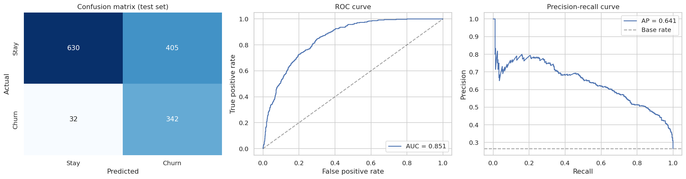

# Customer-Churn-Analytics

Customer churn analysis using SQL, Python, Power BI, and Machine Learning.

A telecom provider loses 26.5% of its customers, which is about $139K of monthly revenue. This project explains who leaves and why, then scores every customer by churn risk so retention efforts can be targeted.

## Highlights

- Month-to-month contracts produce **89% of churners** (42.7% churn vs 2.8% on two-year contracts)
- **47% of customers churn in their first year**; the rate drops below 10% after four years
- Fiber optic + month-to-month + electronic check customers churn at over 70% in the first year
- Logistic regression model: **ROC-AUC 0.85**, catches **91% of churners** at the chosen threshold
- 1,013 active customers are high risk, representing **$76K monthly revenue**



## Project structure

```
Customer-Churn-Analytics/
|-- Data/
|   |-- Raw/                  original Telco_customer_churn.xlsx
|   `-- Processed/            cleaned data, model features, customer risk scores
|-- notebooks/
|   |-- 01_Data_Understanding.ipynb
|   |-- 02_Data_Cleaning.ipynb
|   |-- 03_EDA.ipynb
|   |-- 04_Feature_Engineering.ipynb
|   |-- 05_Model_Building.ipynb
|   |-- 06_Risk_Scoring_and_Insights.ipynb
|   `-- 07_SQL_Analysis.ipynb
|-- sql/                      table creation, cleaning, churn analysis, business KPIs
|-- models/                   saved model, metrics, feature importance
|-- powerbi/                  DAX measures, theme and dashboard build guide
|-- reports/                  full written report
|-- images/                   charts used in the notebooks and report
|-- requirement.txt
`-- LICENSE
```

## How to run

```bash
pip install -r requirement.txt
jupyter notebook
```

Run the notebooks in order (01 to 07). Each one reads the output of the previous step from `Data/Processed/`.

To score customers with the saved model:

```python
import joblib, pandas as pd

saved = joblib.load("models/churn_model.joblib")
features = pd.read_csv("Data/Processed/churn_features.csv")
proba = saved["pipeline"].predict_proba(features[saved["features"]])[:, 1]
flagged = proba >= saved["threshold"]
```

## Approach

1. **Understanding and cleaning:** fixed the `Total Charges` type issue (11 blanks for brand-new customers), removed constant columns and checked for duplicates.
2. **EDA:** churn by contract, tenure, internet service, payment method, add-ons and demographics, with chi-square and Mann-Whitney tests.
3. **Feature engineering:** add-on counts, first-year flag, autopay flag, average monthly spend and a high-risk interaction flag. `Churn Score`, `Churn Reason` and `CLTV` are kept out of the model to avoid leakage.
4. **Modelling:** logistic regression, random forest, gradient boosting and histogram gradient boosting compared by cross-validation. The tuned logistic regression was chosen for its near-identical accuracy and easy interpretation. The decision threshold (0.33) favours recall.
5. **Scoring:** cross-validated probabilities for all customers, grouped into Low / Medium / High risk (actual churn 4.9% / 25.0% / 57.6%).
6. **SQL:** churn and revenue queries in `sql/`, run and checked against the pandas results in notebook 07.
7. **Power BI:** data, measures and a page-by-page build guide in `powerbi/`.

## Results

| Metric (test set) | Value |
|---|---|
| ROC-AUC | 0.851 |
| PR-AUC | 0.641 |
| Recall | 91.4% |
| Precision | 45.8% |

See [reports/Churn_Analysis_Report.md](reports/Churn_Analysis_Report.md) for the findings, recommendations and limitations.

## Tools

Python (pandas, NumPy, scikit-learn, matplotlib, seaborn, SciPy), SQL (SQLite syntax), Power BI, Jupyter.

## Dataset

Telco customer churn dataset (7,043 customers, 33 columns).

## License

MIT, see [LICENSE](LICENSE).
