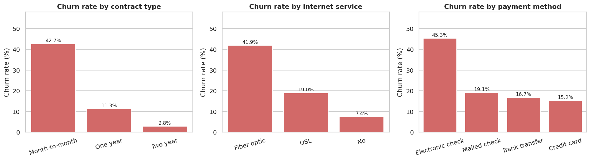
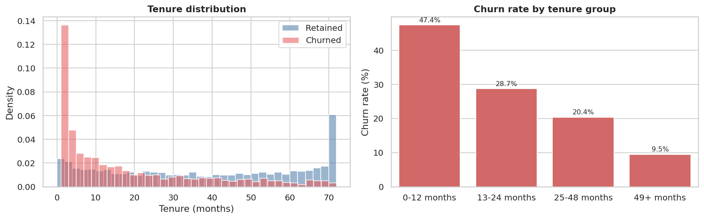
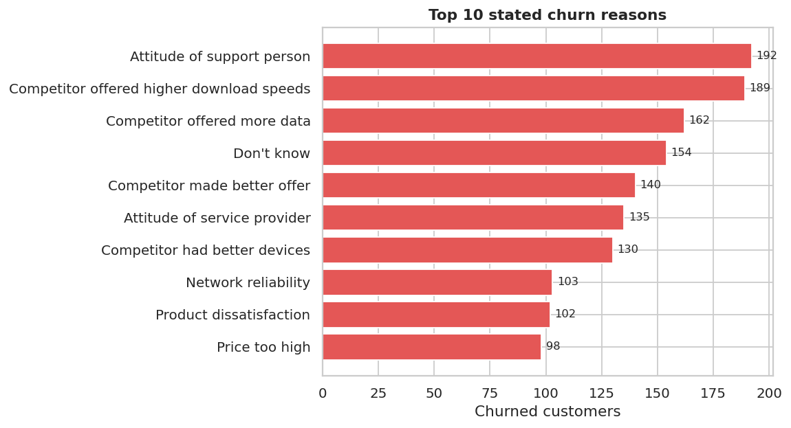
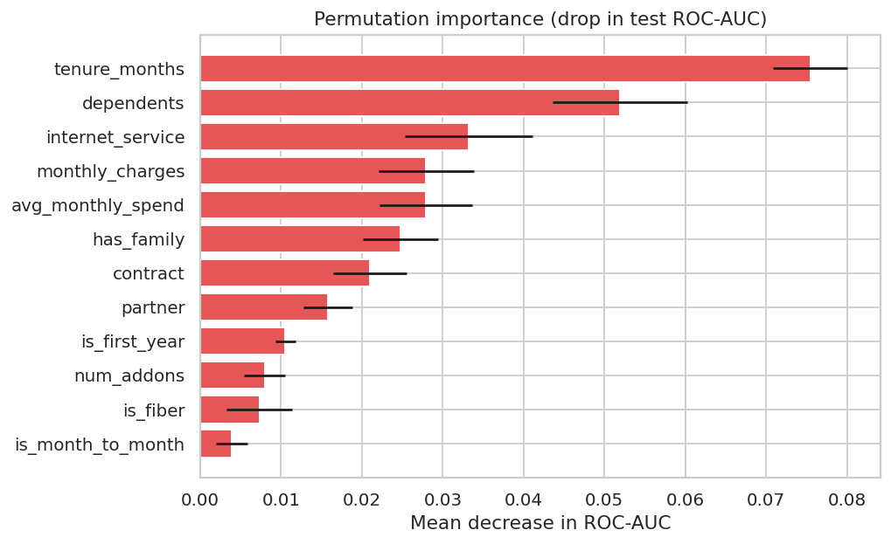

# Customer Churn Analysis - Project Report

## 1. Objective

A telecom provider loses about one in four customers. This project finds out who leaves and why, measures the revenue impact, and builds a model that flags customers at risk so the retention team can act before they go.

## 2. Data

- Source: Telco customer churn dataset (`Data/Raw/Telco_customer_churn.xlsx`), 7,043 customers in California, 33 columns
- Target: `Churn Value` (1 = left, 0 = stayed), 26.5% churn
- Quality: no duplicates; `Total Charges` stored as text with 11 blanks, all brand-new customers (tenure 0) who had not been billed
- Excluded from modelling: `Churn Score` and `Churn Reason` (information that only exists because of the outcome), `CLTV` (modelled value, used for business sizing only), identifiers and location columns

## 3. Method

| Stage | Notebook / file |
|---|---|
| Profiling and quality checks | `notebooks/01_Data_Understanding.ipynb` |
| Cleaning | `notebooks/02_Data_Cleaning.ipynb` |
| Exploratory analysis and statistical tests | `notebooks/03_EDA.ipynb` |
| Feature engineering and train/test split | `notebooks/04_Feature_Engineering.ipynb` |
| Model comparison, tuning, evaluation | `notebooks/05_Model_Building.ipynb` |
| Risk scoring for the dashboard | `notebooks/06_Risk_Scoring_and_Insights.ipynb` |
| SQL analysis | `sql/` and `notebooks/07_SQL_Analysis.ipynb` |
| Dashboard | `powerbi/` |

## 4. Key findings

1. **Contract type is the strongest driver.** Month-to-month customers churn at 42.7%, one-year at 11.3%, two-year at 2.8%. Month-to-month customers make up 88.6% of all churners.
2. **The first year is critical.** 47.4% of customers with 12 months or less of tenure leave, falling to 9.5% after four years.

3. **Fiber optic customers churn more** (41.9% against 19.0% for DSL) even though they pay the most (average $91.50 per month against $58.10 for DSL). Month-to-month fiber customers churn at 54.6%.
4. **Electronic check payers churn at 45.3%,** nearly three times the rate of customers on automatic payment (15.2% to 16.7%).
5. **Protection add-ons matter.** Customers with online security or tech support churn at about 15%, against about 42% without. Churn falls from 56.7% with no protection add-on to 5.3% with all four.
6. **Demographics:** senior citizens churn at 41.7% (23.6% for others); customers with a partner or dependents are more stable. Gender has no effect (p = 0.49).
7. **Stated reasons:** about a third of churners name a competitor (better offer, faster speeds, more data, better devices), and about 31% name service or support problems.

## 5. Revenue impact

| Measure | Value |
|---|---|
| Total monthly recurring revenue | $456,117 |
| Monthly revenue lost to churn | $139,131 (30.5%) |
| Annualised revenue lost | about $1.67 million |
| Revenue lost from month-to-month contracts | $120,847 per month (87% of the total) |

## 6. Predictive model

Four models were compared with 5-fold cross-validation on 80% of the data, then logistic regression and gradient boosting were tuned. All reached about 0.86 cross-validated ROC-AUC. Logistic regression was selected because the accuracy gap to gradient boosting was only 0.001 and it is simple, fast and explainable.

Because a missed churner costs more than an unneeded retention offer, the decision threshold was set to 0.33 by maximising F2 on cross-validated training predictions.

| Test set metric (1,409 customers) | Value |
|---|---|
| ROC-AUC | 0.851 |
| PR-AUC | 0.641 |
| Recall at threshold 0.33 | 91.4% (342 of 374 churners caught) |
| Precision at threshold 0.33 | 45.8% |
| Accuracy at threshold 0.33 | 69.0% |
| Recall / precision at threshold 0.50 | 80.2% / 51.4% |

The trade-off is deliberate: at 0.33 the model flags 39% of loyal customers to catch 91% of leavers. If retention offers are expensive, a higher threshold such as 0.50 gives better precision with 80% recall.

Most influential features (permutation importance): tenure, dependents/family status, internet service, monthly charges, and contract.

## 7. Risk bands

Every customer was scored with out-of-fold probabilities and put in a band.

| Band | Customers | Actual churn rate |
|---|---|---|
| Low | 3,334 | 4.9% |
| Medium | 1,322 | 25.0% |
| High | 2,387 | 57.6% |

Among customers who have not churned, **1,013 are High risk and represent $76,139 in monthly revenue** (about $4.2M in lifetime value). 662 of them are month-to-month fiber customers.

## 8. Recommendations

1. **Move month-to-month customers to longer contracts** with a first-year discount or bundle. This targets the group that produces nearly nine in ten churners.
2. **Strengthen onboarding for the first 12 months:** check-in calls, early-life offers and a service review at months 3 and 9.
3. **Bundle Online Security and Tech Support** (free trial or discount) for fiber customers. 55% of fiber customers without either churn.
4. **Encourage automatic payment** with a small bill credit for electronic-check customers.
5. **Review fiber pricing and speed against competitors,** the most common stated reason for leaving.
6. **Improve support quality:** attitude of support staff is the most cited single reason for leaving.
7. **Use the risk scores weekly:** work the High-risk active list first, ordered by lifetime value.

## 9. Limitations

- The data is a single snapshot, so the model cannot see how behaviour changes over time (for example support calls or billing disputes in the months before a customer leaves).
- The dataset covers one state; patterns may not transfer elsewhere.
- Precision is moderate by design. Retention offers should be cheap enough that contacting some customers who would have stayed is acceptable.
- Findings show association, not proof of cause. For instance, the link between add-ons and lower churn should be tested with a controlled offer before assuming it is causal.

## 10. Next steps

- Test retention offers with an A/B design to measure real uplift
- Add behavioural data (usage, tickets, outages) and retrain
- Schedule monthly scoring and refresh the dashboard
